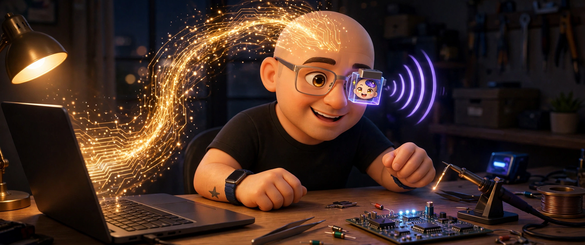
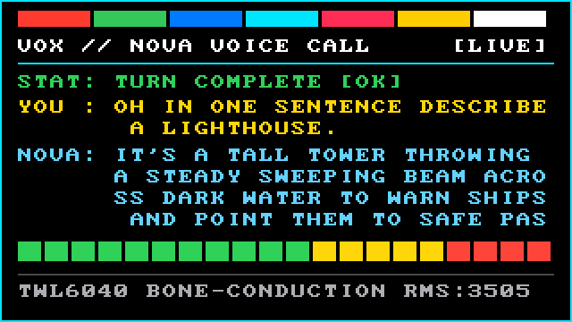

# metamuse-glass

**A new Linux operating system for Google Glass Explorer Edition (2014) that turns the glasses into a Meta Muse voice gadget** — no Android, no Google account, no Google services. The Glass pairs with the Muse phone app over Bluetooth LE, places realtime voice calls into a Muse chat, shows a live heads-up display on the prism, and answers through the bone-conduction speaker.

The hardware itself is **Prism**, the device name this unit carries among its owner's other gadgets. This repo is its Muse gadget firmware.

## Status: working on real hardware

Built and verified on an original 2014 Explorer unit in October 2026. Every milestone passed on the device itself, not in an emulator:

- **M0** — Boot-image pipeline: Google's stock XE24 kernel (byte-for-byte, verified by hash) repacked with a custom Alpine Linux initramfs, inside the 8 MiB boot partition ceiling.
- **M1** — First boot from RAM (`fastboot boot`, nothing flashed): custom framebuffer UI live on the 640×360 prism.
- **M2** — Wi-Fi up on the BCM4330 with a modern TLS stack: HTTPS requests succeed from a kernel Google shipped in 2014.
- **M3** — **Muse Gadget BLE pairing: GO.** The pairing handshake with the Muse phone app completed over Bluetooth LE on the 3.4 kernel — the milestone this project treated as its go/no-go cliff. It took a raw-HCI advertising fallback and an L2CAP shim; the story is in [docs/HOW-IT-WORKS.md](docs/HOW-IT-WORKS.md).
- **M4** — Live end-to-end encrypted voice call from the glasses: question in through the mic, spoken reply out through the bone-conduction transducer, live HUD on the prism throughout.
- **M5** — Camera-to-chat: the physical camera button snaps a frame, the photo uploads into the same Muse conversation, and the spoken description streams back with lip-sync. Plus the full-screen animated HUD modes, switched from the touchpad.

### Since the 1.0.0 release (firmware 0.2.x)

The glasses kept going after the first public release. The current build (synced from firmware **0.2.3**) adds:

- **A control plane for a pair of glasses.** The on-device `glass-agentd` daemon serves an authenticated HTTP API (status, screenshots, telemetry, archived voice and camera turns, card/brightness/audio/camera/voice/update controls), and [`mcp/glass_mcp.py`](mcp/glass_mcp.py) wraps it in **19 MCP tools** — `glass_status`, `glass_health_audit`, `glass_screenshot`, `glass_set_card`, `glass_set_hud`, `glass_set_brightness`, `glass_set_audio_route`, `glass_chime`, `glass_voice_turn`, `glass_camera_snap`, `glass_camera_record`, `glass_prism_record`, `glass_ask_nova`, `glass_notify_hud`, `glass_fetch_archives`, `glass_switch_os`, `glass_ota_update`, `glass_exec`, `glass_reboot` — so any MCP-capable assistant can drive the glasses.
- **Realtime streaming voice.** Microphone and reply stream in both directions at once (`POST /voice/realtime`); transcripts appear on the prism word by word as they are spoken.
- **An on-device settings card.** Volume, brightness, audio output (bone transducer or USB earbud), desk sleep, and the OS switch, all from the temple touchpad, with the physical back button as its shortcut.
- **Camera recording.** `glass-camera-record` captures 1–15 second clips through the Ducati coprocessor, alongside stills.
- **Dual-boot chooser.** A second, local system shares the same hardware layer and co-resides on the device; a guarded two-finger hold (or an MCP call) hot-swaps between the two in under 200 ms. Grabbing the glasses by the temple arm never triggers it.
- **Untethered operation.** The glasses cold-boot standalone from internal storage — no cable, no fastboot — and take boot-image updates over Wi-Fi with SHA-256 readback verification. SSH is keys-only.
- **A thermal pass that matters on your face.** Cached framebuffer diffing, adaptive polling, and a 300 MHz idle floor took the HUD's idle CPU from 13% to 2% and the board temperature down by about 4 °C, on a 570 mAh battery worn against your temple. A glasshub don/doff sensor pass sleeps the prism when the glasses are off your head.

Screenshots for every milestone are in [docs/screenshots/](docs/screenshots/), the recorded voice turns are in [docs/audio/](docs/audio/), and the builder's own results log is [docs/RESULTS.md](docs/RESULTS.md). A montage of the on-device captures (voice HUD, avatar, camera card) is on Mux: [player.mux.com/lyqjE7U5dS3wIptPiF1YHMsHGsMhjkIdxUMGFj79VNA](https://player.mux.com/lyqjE7U5dS3wIptPiF1YHMsHGsMhjkIdxUMGFj79VNA).

## Created with Gemini 4 Argon

The planning, the research synthesis, the build pipeline, and the code in this repository were created with **Google's Gemini 4 Argon**, accessed through Antigravity, working from a written brief and milestone contract, directed and hardware-tested by the repo owner. A Google AI wrote a new operating system for Google Glass, a dozen years after Google walked away from it.

## How it works, in one paragraph

Prism keeps Google's stock XE24 kernel — the bootloaders below it have no public source and are treated as fixed — and replaces everything above it: an Alpine armv7 userland, a framebuffer UI written in C, the BCM4330 driven with its stock firmware blobs, and Meta's Muse Gadget SDK Linux client (`musegadget`, Python) hand-installed for a non-systemd system. Because BlueZ's GATT stack would not serve pairing on the 3.4 kernel, the firmware advertises with raw HCI commands and shims the L2CAP address-type handling the SDK expects. Voice runs WAV-first (PCM 24 kHz mono, exactly as the SDK wants it) through a small C bridge that speaks the old kernel's ALSA ioctl ABI and resamples to the codec's 48 kHz. Details: [docs/HOW-IT-WORKS.md](docs/HOW-IT-WORKS.md).

One clarification, stated plainly: the glasses are an endpoint. The voice conversation lives in the owner's Muse account and terminates at Meta's cloud service; nothing about the voice path touches the owner's home servers.

## Documentation

- [docs/NARRATIVE.md](docs/NARRATIVE.md) — the story: a 2014 purchase, a decade in a drawer, and the night it got a new OS
- [docs/narrative/](docs/narrative/) — the session-by-session build record: [first light and first voice](docs/narrative/2026-10-30-first-light-and-first-voice.md), [camera, control plane, and untethered boot](docs/narrative/2026-10-30-prism-core-camera-mcp-and-untethered-boot.md)
- [docs/HOW-IT-WORKS.md](docs/HOW-IT-WORKS.md) — architecture and the three hard problems (userland, Bluetooth, audio), plus the control plane
- [docs/MILESTONES.md](docs/MILESTONES.md) — what each milestone required and how it was verified
- [docs/BUILDING.md](docs/BUILDING.md) — build and first-boot instructions, firmware hashes, safety rules
- [docs/RESULTS.md](docs/RESULTS.md) — the builder's full results log from the hardware sessions
- [docs/PRIOR-ART.md](docs/PRIOR-ART.md) — who did what first, and what this project stands on

## Safety

Never write the xloader, bootloader, fpga, or sensor-hub partitions — there is no public source for them and no recovery if they corrupt. The official XE24 factory image is the recovery floor; test every image with `fastboot boot` before flashing anything. The build wrapper enforces the partition allowlist in code.

## Credits and license

This project stands on other people's work, credited in [docs/PRIOR-ART.md](docs/PRIOR-ART.md) and [NOTICE.md](NOTICE.md): most importantly [glass-xec-mainline](https://github.com/Lasimeri/glass-xec-mainline) (MIT), the first published Alpine-on-Glass system, whose platform work this build learned from; the postmarketOS project's 2017 Glass port; Meta's Muse Gadget SDK; and Google's published Glass kernel sources.

Code in this repository is MIT licensed, © 2026 Nic Lydon — see [LICENSE](LICENSE). Firmware binaries are **not** distributed here; [firmware/README.md](firmware/README.md) documents their provenance and hashes so you can extract them from Google's factory image yourself.
