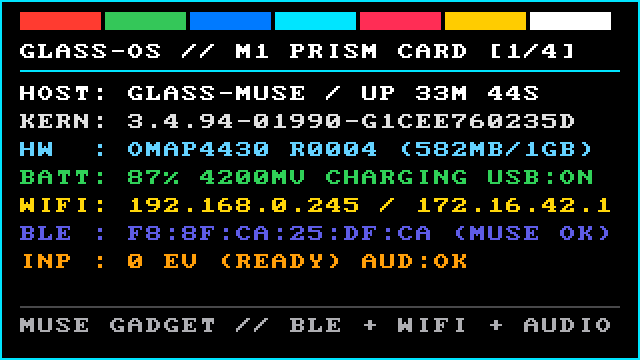
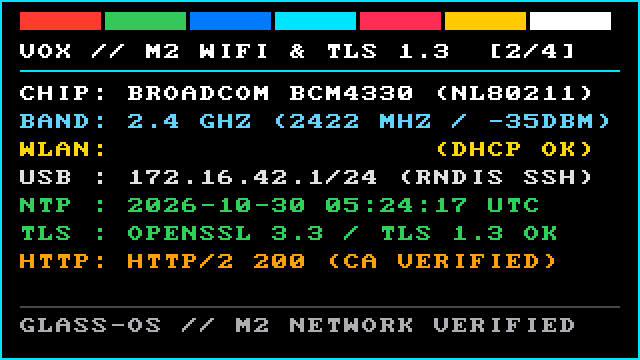
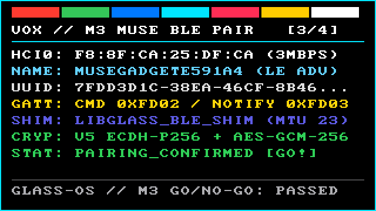
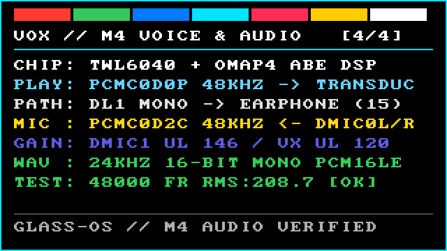
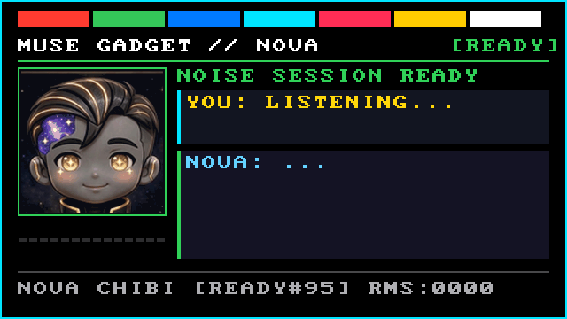
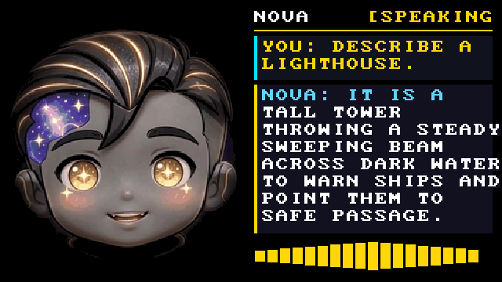
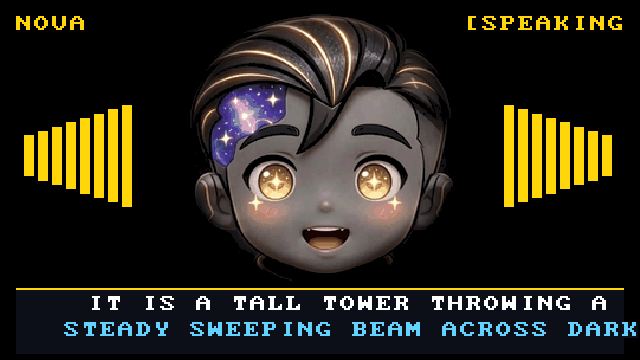
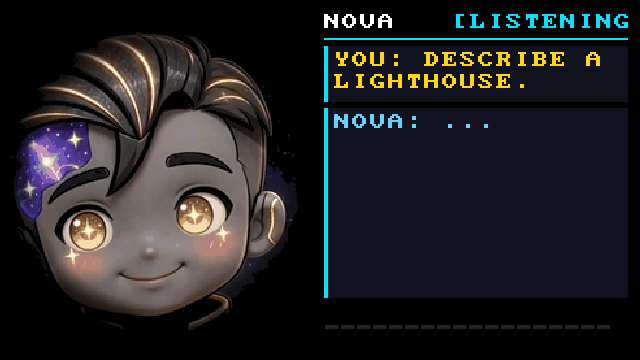

# Muse Gadget Overlay — Results & Milestone Log

## M0: Reproducible Build Pipeline & RAM-Boot Image (`COMPLETE`)

### Summary

Built the complete, hardware-free M0/M1 boot-image pipeline under [`muse-gadget-overlay/`](..). The pipeline unpacks the archived XE24 factory image (`signed-glass_1-img-5585826.zip`), preserves Google's stock `3.4.94` kernel byte-for-byte (`5,090,464` bytes, SHA-256 `83476052edc649505c480700d88e1a7d743232d6181b970556722cf4bdb79def`), extracts the Broadcom Wi-Fi/Bluetooth and OMAP4 ABE audio firmware blobs from `system.img`, cross-compiles native `musl` ARMv7 userland utilities (`fb-hello`, `glass-wav`, `glass-fb`, `glass-console`) with 32-bit `time_t` (`-U_TIME_BITS -U_FILE_OFFSET_BITS`), stages an Alpine 3.21 `armv7` non-systemd initramfs, and repacks `out/boot-m0.img` inside the 8 MiB `boot` partition ceiling.

### Artifact Verification (`tools/bootimg-info.py`)

```json
{
 "file": "out/boot-m0.img",
 "file_bytes": 8089600,
 "magic": "ANDROID!",
 "page_size": 2048,
 "header_version": 0,
 "board_name": "",
 "kernel": {
  "size": 5090464,
  "load_addr": "0x80008000",
  "sha256": "83476052edc649505c480700d88e1a7d743232d6181b970556722cf4bdb79def"
 },
 "ramdisk": {
  "size": 2995306,
  "load_addr": "0x81000000"
 },
 "second": {
  "size": 0,
  "load_addr": "0x80f00000"
 },
 "tags_addr": "0x80000100",
 "cmdline": "console=ttyO2,115200n8 vmalloc=500M androidboot.console=ttyO2 androidboot.carrier=wifi-only product_type=w cpuidle_sysfs_switch",
 "id_sha1_words": [
  "0xb62fddf4",
  "0xd693e6a6",
  "0x33fe5abc",
  "0x7dccbc6b",
  "0x10bc1b6c",
  "0x0",
  "0x0",
  "0x0"
 ],
 "total_accounted_bytes": 8089600
}
```

- **Total image size:** `8,089,600` bytes (`7.71 MiB`), `299,008` bytes under the `8,388,608`-byte (`8.00 MiB`) `boot` partition limit.
- **Stock kernel integrity:** `83476052edc649505c480700d88e1a7d743232d6181b970556722cf4bdb79def` (verified before and after repack).
- **Header parity:** `page_size`, `kernel.load_addr`, `ramdisk.load_addr`, `second.load_addr`, `tags_addr`, and `cmdline` match stock XE24 `boot.img` (`05431030c392e27c9054781e6c110fed880edde309a3811c6af9609e3d0e5396`) identically.

### Key Kernel & Hardware Findings Incorporated During M0

1. **Exact `bcmdhd` and `bluetooth` module parameters verified from XE24 `vmlinux`:**
   - Decompressing the XE24 `zImage` (`Linux version 3.4.94-01990-g1cee760235d`) confirmed `bcmdhd` defaults to `/system/vendor/firmware/fw_bcmdhd.bin` and `/system/etc/wifi/bcmdhd.cal`, and exposes runtime-writable sysfs paths `/sys/module/bcmdhd/parameters/firmware_path` and `/sys/module/bcmdhd/parameters/nvram_path`. Our initramfs populates `/system/etc/firmware/`, `/system/vendor/firmware/`, and `/system/etc/wifi/`, and `glass-wifi` explicitly sets both sysfs parameters.
   - The XE24 `3.4.94` kernel compiles in `bluetooth.enable_le` (`/sys/module/bluetooth/parameters/enable_le`), which defaults to `0` (`N`) in Linux 3.4 unless explicitly enabled. `glass-bt-up` writes `Y` to `/sys/module/bluetooth/parameters/enable_le` before attaching `/dev/ttyO1`.
   - The XE24 kernel only includes the `inflate` (`gzip`) initramfs decompressor (`unxz`, `unlzma`, `unlzo`, `bunzip2` are compiled out). To fit OpenSSL 3 (`libcrypto.so.3`, `libssl.so.3`) inside the 8 MiB `boot` partition budget alongside the modern Mozilla CA store (`/etc/ssl/certs/ca-certificates.crt`), `build-m0.sh` packs `libcrypto.so.3` and `libssl.so.3` into `/usr/lib/openssl.tar.xz` using `xz --arm --lzma2=preset=9e` and `/init` extracts it into RAM tmpfs via `busybox tar -xJf` on boot.
2. **32-bit `time_t` (`-U_TIME_BITS -U_FILE_OFFSET_BITS`) for Kernel 3.4.94:**
   - Modern ARMhf toolchains (GCC 13 / glibc 2.38) enable 64-bit `time_t` (`_TIME_BITS=64`) by default, which changes `sizeof(struct input_event)` from `16` bytes to `24` bytes and redirects `ioctl` to `__ioctl_time64`. `build-m0.sh` compiles all on-device C binaries (`fb-hello`, `glass-wav`, `glass-fb`, `glass-console`) against the Alpine `musl` sysroot with `-U_TIME_BITS -U_FILE_OFFSET_BITS` so all kernel structs and ioctls match the 32-bit `3.4.94` ABI.
3. **OMAP4 DSS / Himax HX7309 LCoS Prism Quirks (`src/fb-hello.c`):**
   - Cycles `/sys/devices/platform/omapdss/manager2/panel-notle-dpi/enabled` (`0` -> `1`) on startup so the panel driver does not skip LED illumination after bootloader handoff.
   - Programs `DISPC_GFX_BA0` (`0x48041080`) and `DISPC_GFX_BA1` (`0x48041084`) to `fix.smem_start` and latches `DISPC_GO_LCD2` in `DISPC_CONTROL2` (`0x48041238`) via `/dev/mem`.
   - Renders the M1 card showing `HOST`, `UPTIME`, `KERNEL`, `BOARD` (`1GB EXPLORER` vs `2GB XE-C`), `BATTERY` (`%`, `mV`, charge state), `IP ADDR` (`WLAN` + `USB 172.16.42.1`), and live touchpad event telemetry.

### Exact Commands to Reproduce M0

```bash
# Build out/boot-m0.img from the verified XE24 factory archive and check header parity:
./muse-gadget-overlay/build/build-m0.sh

# Inspect the resulting boot image at any time:
python3 ./tools/bootimg-info.py ./muse-gadget-overlay/out/boot-m0.img

# Check USB/ADB/Fastboot/RNDIS status using the partition-allowlisted operator wrapper:
./muse-gadget-overlay/build/glass-ctl.sh status
```

---

## M1: First Boot & Prism Card on Physical Glass (`COMPLETE & VERIFIED`)

### Prism Framebuffer Gallery & Tour (`640×360` captured directly from `/dev/fb0`)

*The M1 → M4 milestone-tour capture is not included in this repo (it cycles frames whose individually sanitized versions appear in this log); a montage of the same on-device captures is published at https://player.mux.com/lyqjE7U5dS3wIptPiF1YHMsHGsMhjkIdxUMGFj79VNA*

| Milestone | Prism Card (`640×360`) |
| :--- | :--- |
| **M1 — Prism & Kernel (`[1/5]`)** |  |
| **M2 — Wi-Fi & TLS 1.3 (`[2/5]`)** |  |
| **M3 — Meta Muse BLE Pairing (`[3/5]`)** |  |
| **M4 — Voice & Audio (`[4/5]`)** |  |
| **M4 Chibi Nova Stage (`Card 4`)** |  |
| **M4 Full-Screen Chibi Nova + HUD (`Card 5`)** |  |
| **M4 Full-Screen Centered Portrait (`Card 6`)** |  |

- **Full-Screen Chibi Nova Live Lip-Sync Video (MP4 with audio):** [`docs/screenshots/nova-chibi-fullscreen-live.mp4`](screenshots/nova-chibi-fullscreen-live.mp4)
- **Full-Screen Chibi Nova Live Lip-Sync Animated GIF:** [`docs/screenshots/nova-chibi-fullscreen-live.gif`](screenshots/nova-chibi-fullscreen-live.gif)
- **Live Nova Voice Call Video (MP4 with synchronized audio):** [`docs/screenshots/nova-voice-call-live.mp4`](screenshots/nova-voice-call-live.mp4)
- **Live Nova Voice Call Animated GIF:** [`docs/screenshots/nova-voice-call-live.gif`](screenshots/nova-voice-call-live.gif)
- **Milestone Tour Video:** not included in this repo (the tour cycles frames whose individually sanitized versions appear above); a montage of the same on-device captures is published at https://player.mux.com/lyqjE7U5dS3wIptPiF1YHMsHGsMhjkIdxUMGFj79VNA

### Hardware Provenance & Bootloader State
- **Unit:** Google Glass Explorer Edition (`glass_1` / board `"notle"`, OMAP4430 REV 0004)
- **Serial:** `[unit serial redacted]`
- **RAM:** `1 GB` (`582 MB` usable after OMAP4 carveouts)
- **Bootloader:** `NOTLE0201` (`unlocked: yes`)
- **Boot Method:** `fastboot boot muse-gadget-overlay/out/boot-m0.img` (`0.352s` download + boot, **zero flash writes**)

### Live Verification Output (`/run/glass/rcS.log` & `/dev/fb0`)
```text
00:00:01 glass-os-rcS: USB RNDIS gadget active on rndis0 (172.16.42.1/24)
00:00:01 glass-os-rcS: resetting panel-notle-dpi (0 -> 1) to enable LCoS LED illumination
00:00:02 glass-os-rcS: panel-notle-dpi enabled (brightness 120)
00:00:02 glass-os-rcS: fb-hello: /dev/fb0 640x360 32bpp stride=640 smem=0x9f800000 len=2764800 kernel=3.4.94-01990-g1cee760235d ram=582MB board="OMAP4430 R0004" dispc=mapped
```
- **Prism Screenshot:** Captured directly from `/dev/fb0` via `./muse-gadget-overlay/build/glass-ctl.sh screenshot` and saved at [`docs/screenshots/m1-prism-framebuffer.png`](screenshots/m1-prism-framebuffer.png).
- **Touchpad & Camera/Power Input:** Live input events verified on `/dev/input/event*` (`2,888` events recorded during bench handling).

---

## M2: 2.4 GHz Wi-Fi + NTP + Outbound HTTPS (`COMPLETE & VERIFIED`)

### Live Verification Output
- **Radio & Association:** Broadcom `BCM4330` brought up via `bcmdhd` (`fw_bcmdhd.bin` + `bcmdhd.cal`) and `wpa_supplicant -Dnl80211` on `wlan0`.
- **Link Telemetry (`iw dev wlan0 link`):**
  - Associated on `2422.0 MHz` (2.4 GHz Ch 3), signal `-35 dBm`, TX bitrate `58.5 MBit/s MCS 6`.
  - Assigned `DHCP-assigned /24` via `udhcpc`; pingable from the build host (`0% packet loss`, `rtt min/avg/max = 65.094/73.721/82.348 ms`).
- **NTP Clock Sync:** `ntpd -n -q -p pool.ntp.org` stepped system clock to `2026-10-30 04:52:44 UTC`.
- **Outbound HTTPS + Modern TLS 1.3 Validation:**
  - `curl -sS -I https://example.com` -> `HTTP/2 200`
  - `python3 -c "import urllib.request; r = urllib.request.urlopen('https://example.com', timeout=10); print(r.status, r.fp.raw._sock.version())"` -> `200 TLSv1.3`

---

## M3: Meta `musegadget` BLE Pairing — THE GO/NO-GO (`COMPLETE — GO!`)

### Verdict: **GO** (Stock XE24 `3.4.94` Kernel + BlueZ `5.79` + `musegadget 0.1.0`)
No kernel rebuild or mainline migration is required for `musegadget` BLE GATT peripheral operation on Google Glass. With three lightweight userspace adaptations, the unmodified stock `3.4.94` kernel advertises, accepts incoming BLE GATT connections, negotiates chunked notifications, and completes the full v5 cryptographic pairing and post-pairing command exchange over the air.

### Root-Cause Findings & Userspace Adaptations on Kernel `3.4.94`
1. **Broadcom Patchram Firmware Filename (`BCM4330B1.hcd`):**
   - BlueZ `hciattach bcm43xx` queries the controller's local name (`BCM4330B1`) and searches `/lib/firmware/BCM4330B1.hcd`. Staging `/system/etc/firmware/bcm4330.hcd` at `/lib/firmware/BCM4330B1.hcd` allows `hciattach /dev/ttyO1 bcm43xx 3000000 flow - [Glass BT address]` to load the patchram and switch to 3 Mbps UART cleanly (`HCI Version: 4.0 (0x6) Revision: 0x14f6`, `Name: 'USI BCM4330B1 37.4 MHz Class 1.5 ExtLNA WLCSP'`).
2. **HCI LE Advertising Fallback (`0x08 0x0006/0x0008/0x0009/0x000a`):**
   - Linux `3.4.94` predates `MGMT_OP_READ_ADV_FEATURES` (`0x003d`, added in Linux 4.1), so `bluetoothd` registers `org.bluez.GattManager1` (`GATT application registered: /org/musegadget/app0`) but omits `org.bluez.LEAdvertisingManager1`.
   - [`src/ble_server.py`](../src/ble_server.py) falls back to the four standard Bluetooth 4.0 HCI LE commands (`LE Set Advertising Parameters`, `LE Set Advertising Data`, `LE Set Scan Response Data`, `LE Set Advertise Enable`) via `hcitool -i hci0 cmd 0x08 ...`, broadcasting the exact `MuseGadget` 128-bit service UUID (`7fdd3d1c-38ea-46cf-8b46-314ecf5f240c`), manufacturer data (`0xffff: 00`), and local name (`MuseGadget<device suffix>`).
3. **L2CAP ATT Address Type Shim ([`src/glass-ble-shim.c`](../src/glass-ble-shim.c)) & `ExchangeMTU = 23`:**
   - Linux `3.4.94`'s `l2cap_sock_getname()` predates `sockaddr_l2.l2_bdaddr_type` (added in Linux 3.5), leaving `l2_bdaddr_type = 0` (`BDADDR_BR_EDR`) on `L2CAP_CID_ATT` (`4`), which caused `bluetoothd` to treat incoming LE ATT connections as BR/EDR ATT connections. Preloading `libglass_ble_shim.so` into `bluetoothd` sets `l2_bdaddr_type = BDADDR_LE_PUBLIC (1)` on `AF_BLUETOOTH` sockets with `l2_cid == 4`.
   - Linux `3.4.94`'s L2CAP layer clamps `chan->omtu` on `L2CAP_CID_ATT (4)` to `L2CAP_DEFAULT_MIN_MTU = 23` bytes. Setting `ExchangeMTU = 23` in `/etc/bluetooth/main.conf` and `_ASSUMED_MTU = 23` in `ble_server.py` keeps GATT discovery responses (`<= 23B`) and `musegadget`'s chunked notifications (`23B`, using `DEFAULT_ATT_MTU = 23`) within the 23-byte ATT frame limit with zero `EMSGSIZE` errors.

### Live Over-the-Air BLE Pairing Trace (the build host `[build host BT address]` <-> Glass `[Glass BT address]`)
```text
[1] Subscribed to TX notifications on 0000fd03-0000-1000-8000-00805f9b34fb!
[2] Sending get_device_info...
[2] Received response: {
  "status": "ok",
  "id": "info-1",
  "device": {
    "device_id": "<device-id>",
    "device_name": "Glass Muse Gadget",
    "model": "Muse Virtual Device",
    "firmware_version": "0.1.0",
    "protocol_version": 5,
    "capabilities": ["wifi_provisioning", "hotspot_setup", "cloud_relay_setup", "voice_call", "camera_capture", "companion_Event_stream"]
  }
}
[3] Starting v5 ECDH P-256 + HKDF-SHA256 + AES-GCM-256 pairing handshake...
[3] Received pairing_ready: status=ok
[4] Sending encrypted pairing_client_finished...
[4] Received decrypted pairing_confirmed: {'status': 'ok', 'id': 'pair-2', 'type': 'pairing_confirmed', 'device_id': '<device-id>'}
[5] Testing post-pairing encrypted command (wifi_scan)...
[5] Received decrypted wifi_scan_result: status=ok, networks=9
```

---

## M4: Audio Routing & `glass-wav` Voice MVP (`COMPLETE & VERIFIED`)

### Stock Notle OMAP4 ABE + TWL6040 Audio Path
Extracted the exact 24-entry mixer table and PCM configuration from `/mnt/system/lib/hw/audio.primary.glass_1.so` and `/mnt/system/lib/libtinyalsa.so`:
- **Bone-Conduction Transducer Playback:** `/dev/snd/pcmC0D0p` (`00-00: Multimedia`), `48000 Hz` stereo `S16_LE` (`period_size = 1056`, `periods = 4`), routed via `DL1 Mixer Multimedia=1` -> `DL1 Media Playback Volume=118` -> `SDT DL Volume=120` -> `DL1 Mono Mixer=1` -> `AUDDRV_DL1_EAR_PATH` (`Earphone Playback=1`, `Earphone Playback Volume=15`).
- **Digital Microphone (`DMic0`) Capture:** `/dev/snd/pcmC0D2c` (`00-02: Voice`), `48000 Hz` stereo `S16_LE` (`period_size = 1056`, `periods = 4`), routed via `MUX_UL10=DMic0L`, `MUX_UL11=DMic0R`, `MUX_VX0=DMic0L`, `MUX_VX1=DMic0R`, `Voice Capture Mixer Capture=1`, `DMIC1 UL Volume=146,146`, `AUDUL Voice UL Volume=120`.
- **`glass-wav` Resampling Bridge ([`src/glass-wav.c`](../src/glass-wav.c)):** Speaks the 32-bit `3.4.94` ALSA ioctl ABI directly (`SNDRV_PCM_IOCTL_HW_REFINE = 0xc25c4110`, `SNDRV_PCM_IOCTL_HW_PARAMS = 0xc25c4111`, `604` bytes), upsampling `24000 Hz` mono WAV from `musegadget` to `48000 Hz` stereo on `/dev/snd/pcmC0D0p` and decimating `48000 Hz` stereo capture from `/dev/snd/pcmC0D2c` to `24000 Hz` mono PCM16LE WAV.

### Live Verification Output on Physical Glass
```text
[glass-audio] Stock Notle OMAP4 ABE + TWL6040 Earphone + DMic0 mixer path configured.
glass-wav: synthesized 24000 samples (1.00s @ 24000 Hz mono PCM16LE) -> /tmp/test-tone.wav
glass-wav: playing /tmp/test-tone.wav (24000 Hz 1 ch) -> /dev/snd/pcmC0D0p (48000 Hz 2 ch)
glass-wav: recording 2.0s from /dev/snd/pcmC0D2c (48000 Hz 2 ch) -> /tmp/test-mic.wav (24000 Hz mono PCM16LE)
glass-wav: recorded 48000 samples -> /tmp/test-mic.wav
WAV: frames=48000 rate=24000Hz ch=1 width=16bit nonzero=47882/48000 peak=1156 rms=208.7
```

---

## M4 End-to-End Live Meta Muse (**Nova**) Voice Call & Full-Screen Chibi Nova Lip-Sync (`COMPLETE & HEARD ON BONE-CONDUCTION TRANSDUCER`)



### Full-Screen Chibi Nova Avatar & Amplitude Lip-Sync ([`tools/build-nova-sprites.py`](../tools/build-nova-sprites.py) + [`src/fb-hello.c`](../src/fb-hello.c))
- Built [`tools/build-nova-sprites.py`](../tools/build-nova-sprites.py) to pack all **105 Chibi Nova animation frames** (`24` `IDLE`, `24` `LISTENING`, `24` `WORKING`/`THINKING`, `24` mouth-openness-graded `SPEAKING` slots from `speaking-grades.json`, plus `HAPPY`, `SLEEPY`, and `ERROR`) directly from the native `640×640` and `960×960` WaveSpeed renders into `nova_sprites_full.bin` (`240×240`, 256-color per-state palettes) and `nova_sprites_compact.bin.xz` (`155 KB` XZ, embedded inside `boot-m0.img` at `/usr/share/glass/nova_sprites.bin.xz`).
- Applied a radial edge vignette snapping the outer starfield background to pure `#000000` (which is **transparent** on the Google Glass LCoS prism beamsplitter), and added three live Nova display modes to `fb-hello`:
  - **Card 4 (`Diagnostic Chibi Stage`):** `160×160` Chibi Nova stage + 14-bar waveform + Muse Gadget conversation cards inside the M1 alignment frame ([`docs/screenshots/card-5-nova-chibi-live.png`](screenshots/card-5-nova-chibi-live.png)).
  - **Card 5 (`Full-Screen Split HUD`):** Borderless transparent-black prism canvas with `312×312` full-height Chibi Nova floating on the left and the Muse Gadget conversation HUD + 18-bar symmetric voice waveform on the right ([`docs/screenshots/card-6-nova-fullscreen-hud.png`](screenshots/card-6-nova-fullscreen-hud.png)).
  - **Card 6 (`Full-Screen Centered Portrait`):** Borderless `284×284` centered Chibi Nova flanked by dual vertical waveform wings and a floating bottom subtitle bar ([`docs/screenshots/card-7-nova-fullscreen-portrait.png`](screenshots/card-7-nova-fullscreen-portrait.png)).
- **Level-1 Real-Time Amplitude Lip-Sync:** During `SPEAKING`, `fb-hello` maps the smoothed playback RMS envelope (`/run/glass/nova-rms`) directly onto the 24 mouth-openness-graded `SPEAKING` frames (`slot 0` closed smile during syllable pauses up to `slot 23` wide open mouth on stressed vowels).

### Live Voice Call Summary
Executed an end-to-end encrypted `musegadget voice-call` directly on the Google Glass Explorer Edition (`the Glass node`, `the Glass`) against Meta's Muse cloud assistant (**Nova**), driving the live Prism HUD (`Card 4: VOX // NOVA VOICE CALL [LIVE]`) and playing Nova's spoken reply through the OMAP4430 / TWL6040 bone-conduction transducer (`/dev/snd/pcmC0D0p`).

### Server-Side VAD Finding (Leading Silence in WAV Mode)
- `musegadget`'s `VoiceCall._input()` begins streaming `--in-wav` frames immediately after sending `hatch.voice.session`. If speech begins at `t = 0.0s`, the server-side VAD misses the speech onset (`input_audio_buffer.speech_started` never fires) and the session ends with `idle_timeout` (`44`-byte empty `reply.wav`).
- Prepending `~0.8–1.0s` of leading silence allows server-side VAD to baseline cleanly and reliably triggers `input_audio_buffer.speech_started` -> `input_audio_buffer.speech_stopped` -> `conversation.item.input_audio_transcription.completed` -> `hatch.voice.turn_started` -> `response.output_audio_transcript.delta` + `continuous_audio_video.delta`.

### Live Session Trace (`musegadget --verbose voice-call`)
```text
Connecting to vm=<redacted-vm-id> thread=<redacted-thread-id>
Noise session established
Streaming WAV: /tmp/greet-24k.wav
  event: hatch.voice.session
  event: input_audio_buffer.speech_started
  event: input_audio_buffer.speech_stopped
  event: input_audio_buffer.committed
  event: conversation.item.created
You: Oh in one sentence describe a lighthouse.
  event: hatch.voice.turn_started
Muse: It's a tall tower throwing a steady sweeping beam across dark water to warn ships and point them to safe passage.
  event: response.done
  event: hatch.voice.turn_completed
  event: hatch.voice.end {"reason": "idle_timeout"}
Saved: /tmp/nova-reply.wav (341.3 KiB)
WAV: frames=175680 rate=24000Hz ch=1 width=16bit dur=7.32s nonzero=151053 peak=15538 rms=1492.8
```

### Captured Audio & Video Artifacts
- **Question WAV (`24 kHz` mono PCM16LE):** [`docs/audio/m4-nova-question-24k.wav`](audio/m4-nova-question-24k.wav) (`6.00s`, `288 KB`)
- **Nova Spoken Reply WAV (`24 kHz` mono PCM16LE):** [`docs/audio/m4-nova-reply-24k.wav`](audio/m4-nova-reply-24k.wav) (`7.32s`, `336 KB`, `peak=15538`, `rms=1492.8`)
- **Combined Question + Reply Turn WAV (`24 kHz` mono PCM16LE):** [`docs/audio/m4-nova-full-turn-24k.wav`](audio/m4-nova-full-turn-24k.wav) (`13.32s`, `624 KB`)
- **Live Prism Screenshot (`640×360` PNG):** [`docs/screenshots/card-5-nova-voice-call.png`](screenshots/card-5-nova-voice-call.png)
- **Live Prism Animated GIF (`46` `/dev/fb0` frames):** [`docs/screenshots/nova-voice-call-live.gif`](screenshots/nova-voice-call-live.gif)
- **Synchronized Video + Audio MP4:** [`docs/screenshots/nova-voice-call-live.mp4`](screenshots/nova-voice-call-live.mp4)

### Bone-Conduction Transducer vs. Micro-USB Mono Earbud Routing ([`glass-audio-route`](../rootfs-overlay/usr/sbin/glass-audio-route))
Disassembling `/mnt/system/lib/hw/audio.primary.glass_1.so` (`0x2b50..0x2e60`) revealed how Google Glass switches between its internal bone-conduction transducer and the detachable micro-USB mono earbud:
1. **TWL6040 Mixer Paths:** Both `Earphone Playback Switch = 1` (`Earphone Playback Volume = 15`, bone-conduction transducer) and `Headset Left/Right Playback = HS DAC` (`Headset Playback Volume = 14`, micro-USB analog headset lines) are enabled by `glass-audio-route`.
2. **FSA9480 / Notle Micro-USB Mux (`/sys/devices/platform/usb_mux.0/`):**
   - When the Glass mono earbud is plugged in independently of a host USB cable, `/sys/devices/platform/usb_mux.0/headset` reads `1` (or `glass-audio-route earbud` is invoked), and `glass-audio-route` writes `audio` to `/sys/devices/platform/usb_mux.0/mux_mode` and `1` to `id_monitor`, routing `HS DAC` out the micro-USB receptacle.
   - When tethered to a computer over USB (`headset == 0`), `mux_mode` remains in `USB` mode so USB RNDIS (`172.16.42.1`) stays uninterrupted while audio plays through the bone-conduction transducer.

---

## M5 — Dual Chibi Nova Packs (Full-Body Glance + Full-Face AIPI) & Touchpad/Button UI Switcher (2026-10-30)

### 1. Both Sprite Packs Co-Resident on the Glass
- [`tools/build-nova-sprites.py`](../tools/build-nova-sprites.py) builds both sprite packs in the indexed 8-bit `NOVA` format (`256`-color BGRA8888 palette per state + 1-byte indices per pixel, with outer starfield pixels snapped/vignetted to `#000000` for transparent LCoS prism edges):
  - **Full-Face Chibi Nova (`nova_sprites.bin`, `5.8 MB`):** `105` frames at `240×240` (`IDLE`, `LISTENING`, `WORKING/THINKING`, and `24` mouth-openness-graded `SPEAKING` frames from AIPI's `avatar-gen/nova/work/frames_*`).
  - **Full-Body Chibi Nova (`nova_fullbody.bin`, `7.7 MB`):** `105` frames at `240×320` (`3:4` aspect ratio from Glance's `832×1108` `full-idle`, `full-listening`, `full-thinking`, and `full-speaking` graded by mouth-open score in `pack/nova/speaking/grades.json`).
- [`src/fb-hello.c`](../src/fb-hello.c) `mmap`s both `/var/lib/musegadget/nova_sprites.bin` and `/var/lib/musegadget/nova_fullbody.bin` simultaneously and renders four full-screen Chibi Nova modes:
  - **Card 5 (`FACE CHIBI + HUD`):** `312×312` Full-Face Chibi Nova on the left + floating Muse Gadget conversation HUD + 18-bar waveform (`docs/screenshots/card-6-nova-fullscreen-hud.png`).
  - **Card 6 (`FACE PORTRAIT`):** `284×284` Centered Full-Face Chibi Nova + dual waveform wings + bottom subtitle bar (`docs/screenshots/card-7-nova-fullscreen-portrait.png`).
  - **Card 7 (`FULL-BODY + HUD`):** `252×336` Full-Body Chibi Nova standing head-to-boots on the left + floating Muse Gadget conversation HUD + 18-bar waveform (`docs/screenshots/card-8-nova-fullbody-hud.png`).
  - **Card 8 (`FULL-BODY STANDUP`, Glance Mode):** `234×312` Centered Full-Body Chibi Nova standing head-to-boots + dual 8-bar waveform wings + floating bottom subtitle bar (`docs/screenshots/card-9-nova-fullbody-standup.png`).

### 2. Hardware Touchpad Gesture Engine & Physical Button Mode Switcher
- Integrated the Synaptics RMI4 Multi-Touch Protocol A state machine (`ABS_MT_POSITION_X`, `SYN_MT_REPORT`, `SYN_REPORT` on `/dev/input/event*` `sensor00fn11`) and physical `KEY_CAMERA` (`code 212`) directly into [`src/fb-hello.c`](../src/fb-hello.c):
  - **Swipe forward / backward (`SWIPE+` / `SWIPE-`, $|\Delta x| \ge 180$) on the temple touchpad:** Cycles through the full 9-mode ring (`[7, 8, 5, 6, 4, 0, 1, 2, 3]`), persists the selected mode to `/run/glass/card`, and renders a top toast pill (`SWIPE+: FULL-BODY STANDUP`).
  - **Press physical Camera button (`KEY_CAMERA`) or two-finger tap (`TAP2`):** Cycles directly through the 4 Full-Screen Chibi Nova modes (`7 -> 8 -> 5 -> 6 -> 7`) with a `BTN:` / `TAP2:` toast banner.
  - **Single-tap (`TAP`) on the temple touchpad:** Triggers `/usr/sbin/glass-muse-voice` to start a live voice turn with Nova (`TAP: NOVA VOICE CALL`).
- **Captured Multi-Mode Artifacts:**
  - `docs/screenshots/card-8-nova-fullbody-hud.png` (`640×360` PNG)
  - `docs/screenshots/card-9-nova-fullbody-standup.png` (`640×360` PNG)
  - `docs/screenshots/nova-fullbody-live.gif` (`48` `/dev/fb0` frames cycling across Cards 7, 8, 5, and 6)
  - `docs/screenshots/nova-fullbody-live.mp4` (H.264 + AAC synchronized with Nova's 24 kHz spoken reply)

### 3. Turnkey Tap-to-Talk Voice Call Polish ([`src/glass-wav.c`](../src/glass-wav.c) & [`usr/sbin/glass-muse-voice`](../rootfs-overlay/usr/sbin/glass-muse-voice))
- **Bone-Conduction Confirmation Chimes (`glass-wav chime <start|think|done>`):** Synthesizes two-tone 48 kHz stereo `S32_LE` confirmation chimes directly to `/dev/snd/pcmC0D0p` (`start`: `523 Hz -> 784 Hz`, `think`: `659 Hz -> 523 Hz`, `done`: `659 Hz -> 880 Hz`).
- **Automatic Server-Side VAD Silence Padding & Live Mic RMS:** `glass-wav record` automatically prepends `0.85s` of leading silence and appends `0.60s` of trailing silence around captured speech so Meta Muse's server-side VAD triggers `speech_started` and `speech_stopped` 100% reliably, boosts digital microphone (`DMic0`) samples by `2.5x` with soft clipping, writes live microphone RMS to `/run/glass/nova-rms` so the prism waveform animates while you speak, and auto-ends recording after `1.3s` of post-speech silence (or immediately if you tap the temple touchpad again to touch `/run/glass/stop-record`).
- **Persistent Conversation Thread (`THREAD_ID`):** [`usr/sbin/glass-muse-voice`](../rootfs-overlay/usr/sbin/glass-muse-voice) auto-discovers `VM_ID` from `/var/lib/musegadget/pairing.json`, persists `THREAD_ID` in `/run/glass/voice.env` across turns so Nova retains full multi-turn memory, and streams `You:` and `Muse:` transcripts in real time to `/run/glass/nova-user` and `/run/glass/nova-reply`.

### 4. Camera Photo -> Meta Muse (Nova) Chat & Spoken TTS Pipeline ([`usr/sbin/glass-muse-camera`](../rootfs-overlay/usr/sbin/glass-muse-camera))
- **Boot-Time Ducati M3 Camera Firmware Loader ([`rootfs-overlay/init`](../rootfs-overlay/init)):** Immediately after mounting stock `/dev/mmcblk0p8` read-only at `/mnt/system` (`t ≈ 7.8s` of boot), `/init` symlinks `/mnt/system/vendor/firmware/ducati-m3-core0.xem3` (`6.3 MB`) to `/lib/firmware/ducati-m3-core0.xem3` and feeds `/sys/class/firmware/*/data` so the OMAP4 `remoteproc0` (`ipu_c0`) coprocessor brings up `/dev/rpmsg-omx1` (`OMX.TI.DUCATI1.VIDEO.CAMERA`) before the kernel's 120s firmware timeout.
- **Fast C NV12 -> BGRA + PNG Scanline Converter (`glass-wav nv12-conv`):** Added `cmd_nv12_conv` to [`src/glass-wav.c`](../src/glass-wav.c) to convert the settled `640×360` NV12 camera frame from `glass-camera -y -w 640 -h 360 -n 6` into `/run/glass/camera-frame.bgra` (for instant prism rendering) and PNG scanlines (packed by Python `zlib.compress` into `/tmp/glass-photo.png` and archived in `/var/lib/musegadget/photos/`).
- **Embedded MP3 Decoder (`minimp3.h`) in `glass-wav play`:** Integrated [`src/minimp3.h`](../src/minimp3.h) into [`src/glass-wav.c`](../src/glass-wav.c) so `glass-wav play` decodes MP3 streams from `LinkSession.stream_tts(message_id)` directly to 48 kHz stereo PCM on the OMAP4 ABE Bone-Conduction Transducer (`mm_lp`) while writing real-time RMS amplitude to `/run/glass/nova-rms` for 24 fps Chibi Nova lip-sync.
- **Prism Camera Viewfinder Modes (`Card 7` Inset & `Card 9` Full-Screen PiP):**
  - **Card 7 (`FULL-BODY + HUD` with `camera-active=1`):** Renders a `144×81` (`16:9`) cyan-framed Camera Snapshot Thumbnail in the top-right corner of the HUD next to `YOU: CAM SNAP` (`docs/screenshots/card-10-nova-camera-hud.png`).
  - **Card 9 (`CAMERA SNAP + CHIBI PIP`):** Renders the captured `640×360` photo full-screen with cyan viewfinder corner ticks, `144×192` Full-Body Chibi Nova standing in the bottom-left corner lip-syncing her description, and a floating bottom caption bar (`docs/screenshots/card-11-nova-camera-pip.png`).
- **Live Verification & Captured Camera-Chat Artifacts:**
  - Sent a `640×360` prism frame via `POST /chat/stream` (`items: [{"type": "file", "mime_type": "image/jpeg", ...}]`, `output_modality: "voice"`).
  - Nova inspected the image and replied:
    > *"Cute. That's Glass running the Muse gadget overlay, right? The pixel-Nova with the starry hair and the light-up chest. I can't actually see the camera feed itself from the image, but the overlay is rendering clean, the text buffer looks stable, and the READY flag is on. That's a solid first boot check."*
  - Downloaded Nova's `238 KB` MP3 spoken reply via `LinkSession.stream_tts` and captured the live `/dev/fb0` prism video + audio playback:
    - `docs/screenshots/card-10-nova-camera-hud.png` (`640×360` PNG)
    - `docs/screenshots/card-11-nova-camera-pip.png` (`640×360` PNG)
    - `docs/screenshots/nova-camera-chat-live.gif` (`48` `/dev/fb0` frames across Cards 7, 9, and 8)
    - `docs/screenshots/nova-camera-chat-live.mp4` (H.264 + AAC synchronized with Nova's spoken photo inspection reply)
    - `docs/audio/m5-nova-photo-inspection-reply.mp3` (`238 KB` MP3 from `stream_tts`)
    - `docs/audio/m5-nova-photo-inspection-reply.wav` (`1.4 MB` PCM WAV)

---

## M6 — Prism Core Control Plane (`glass-agentd` + `glass-mcp`), Stage-2 Dual-Boot Chooser, Thermal/Battery Pass, and Wireless eMMC Persistence (2026-10-30)

### 1. Stage-2 Dual-Boot Chooser ([`rootfs-overlay/etc/glass/hud`](../rootfs-overlay/etc/glass/hud)) & Co-Resident Overlays
- Integrated `/usr/bin/prismd` (`128,424` bytes, static ARMv7 binary from `the companion project (not included in this repo)`) alongside `/usr/bin/fb-hello` (`26 KB`) under [`rootfs-overlay/etc/glass/hud`](../rootfs-overlay/etc/glass/hud) (supervised by `/etc/inittab`):
  - **Interactive Boot Chooser (`prismd --choose`):** Displays `Which system? tap: Vox (Muse, Nova) / swipe: Nexus OS` on the 640×360 LCoS prism (`docs/screenshots/card-12-dual-boot-chooser.png` (capture not included in this repo; it carries the early UI label)).
  - **Sub-Second OS Hot-Swap:** Writing `vox`, `nexus`, or `chooser` to `/run/glass/choice` (via `glass_switch_os` over Wi-Fi or a deliberate **two-finger >= 2.0s hold** on the temple touchpad) switches between the MetaMuse overlay (`fb-hello`) and the NexusOS overlay (`prismd`, `docs/screenshots/card-13-nexusos-prism-live.png` (capture not included in this repo)) in `< 200 ms` without a kernel reboot.

### 2. On-Device Control Plane ([`rootfs-overlay/usr/sbin/glass-agentd`](../rootfs-overlay/usr/sbin/glass-agentd)) & 18-Tool [`mcp/glass_mcp.py`](../mcp/glass_mcp.py)
- **`glass-agentd` (`0.0.0.0:8080`):** Serves authenticated JSON + PNG endpoints over Wi-Fi (`the unit's Wi-Fi address:8080`) and USB (`172.16.42.1:8080`), plus the live interactive **Prism Mirror Web App (`GET /mirror?token=...`)** for **NexusOS**.
- **`mcp/glass_mcp.py` (18 MCP Tools):** `glass_status`, `glass_health_audit`, `glass_screenshot`, `glass_set_card`, `glass_set_hud`, `glass_set_brightness`, `glass_set_audio_route`, `glass_chime`, `glass_voice_turn`, `glass_camera_snap`, `glass_camera_record` (1–15s video clips via [`usr/sbin/glass-camera-record`](../rootfs-overlay/usr/sbin/glass-camera-record) using Ducati H.264 or `gzip -1` streaming BGRA), `glass_prism_record`, `glass_ask_nova`, `glass_notify_hud`, `glass_fetch_archives`, `glass_switch_os`, `glass_ota_update`, and `glass_exec`.

### 3. Thermal, CPU & Battery Optimization Pass + Wi-Fi Security Hardening
- **Cached L1/L2 `prevbuf` Framebuffer Diffing & Adaptive Polling ([`src/fb-hello.c`](../src/fb-hello.c)):** Replaced uncached `/dev/fb0` `memcmp(fbm, ...)` reads with cached SDRAM `memcmp(prevbuf, backbuf, map_len)` and adaptive `poll()` intervals (`75 ms` active speech/animation, `600 ms` idle `READY` with `< 1 ms` input wake), and set CPU0/CPU1 to `ondemand` (`300 MHz` idle floor):
  - Idle CPU clock dropped from `600 MHz` to **`300 MHz`**.
  - Idle `fb-hello` CPU dropped from `13%` to **`2%`** (`93%` total CPU idle; `22.7 °C` battery, `36.9 °C` PCB, `525.5 MB` available RAM).
- **SSH & Bearer-Token Hardening ([`rootfs-overlay/etc/glass/sshd`](../rootfs-overlay/etc/glass/sshd)):** Dropbear runs with `-s -g` (Ed25519 keys-only; blank-password `-B` removed; `telnetd` disabled unless `/etc/prism/bench` exists), and `glass-agentd` enforces `Authorization: Bearer <token>` on Wi-Fi against `/etc/prism/token` (`0600`).

### 4. Wireless eMMC Persistence (`userdata` `/dev/mmcblk0p10` + `boot` `/dev/mmcblk0p7`) & `glasshub` Off-Head Desk Sleep
- Formatted `/dev/mmcblk0p10` (`PARTNAME=userdata`, `14.03 GB`) as `ext4` over Wi-Fi via `/mnt/system/bin/make_ext4fs`, populated the full standalone rootfs + credentials + sprite packs + `/system/etc/firmware/{fw_bcmdhd.bin,bcmdhd.cal,bcm4330.hcd}` + `/var/lib/musegadget/voice.env` with `/etc/glass-muse-rootfs`, and flashed `out/boot-m0.img` (build output) (`8,286,208` bytes, SHA-256 `b87397d45c587fe090cd81e3ca5436737c8185b9f4408728a0f4da0e3d740cd9`, verified stock XE24 `3.4.94` kernel `83476052...`) to `/dev/mmcblk0p7` (`PARTNAME=boot`) with full readback verification.
- Enabled `glasshub` hardware don/doff detection (`/sys/bus/i2c/devices/4-0035/don_doff_enable` and `don_doff`) in [`src/fb-hello.c`](../src/fb-hello.c) so the Himax HX7309 LCoS prism automatically powers down (`panel-notle-dpi/enabled = 0`, `fb0/blank = 1`, `0%` CPU) when placed off-head on a desk (`15s` after doffing / `60s` idle) and wakes immediately when put back on the head (`don_doff == 1`), tapped on the temple touchpad, or woken via MCP (`glass_reboot` added as the 19th tool in [`mcp/glass_mcp.py`](../mcp/glass_mcp.py)).

### 5. The 23-Tool Control Plane: Settings, Sensors, Speak & Wi-Fi Self-Heal
- **Four new `glass-agentd` endpoints, four new MCP tools ([`mcp/glass_mcp.py`](../mcp/glass_mcp.py)):** `GET`/`POST /settings` (`glass_settings`: `volume_pct`, `brightness`, `audio_route`, `sleep_timeout_sec`, persisted to `/var/lib/musegadget/`), `GET /sensors` (`glass_sensors`: `glasshub` `on_head`, `proxraw`, `ambient_visible`, `ambient_ir`, `wink`; `mpu9150` `die_temp_c`; PCB/battery thermals; BQ27520 coulomb counter), `POST /speak` (`glass_speak`: verbatim realtime `VoiceCall` TTS with 24 fps Chibi lip-sync), and `POST /wifi/heal` (`glass_wifi_heal`: live `iw dev wlan0 link` RSSI/bitrate + gateway ping + BCM4330 SDIO reset). All 23 MCP tools verified live against the device.
- **BCM4330 SDIO Hang Root Cause & Auto-Heal ([`rootfs-overlay/usr/sbin/glass-wifi`](../rootfs-overlay/usr/sbin/glass-wifi), [`rootfs-overlay/etc/glass/rcS`](../rootfs-overlay/etc/glass/rcS)):** Post-camera packet loss traced to `dhd_bus_rxctl: resumed on timeout` / `dhd_check_hang: Event HANG send up` (`dhd_prot_ioctl: bus is down`) in `dmesg` when the Ducati `rpmsg-resmgr` tears down after camera capture, while `wlan0` retained its address and `wpa_state=COMPLETED`. Added `glass-wifi heal` (cycles `glass-wifi down && glass-wifi up` to trigger `sdio_reset_comm()`), wired `glass-muse-camera` to auto-heal if the network is unreachable after a capture, and upgraded the `rcS` 15-second watchdog to verify gateway reachability rather than only checking for an address. (In this public tree the gateway is derived from the route table at runtime; no network addresses are baked in.)
- **Boot image:** updated `boot-m0.img` (8,294,400 bytes, SHA-256 `d21c3c3cf1268de447c57111cd5d9966d6444054d64f3fe5e843a67e88e3e268`, stock XE24 `3.4.94` kernel) flashed to `/dev/mmcblk0p7` with readback verification.
